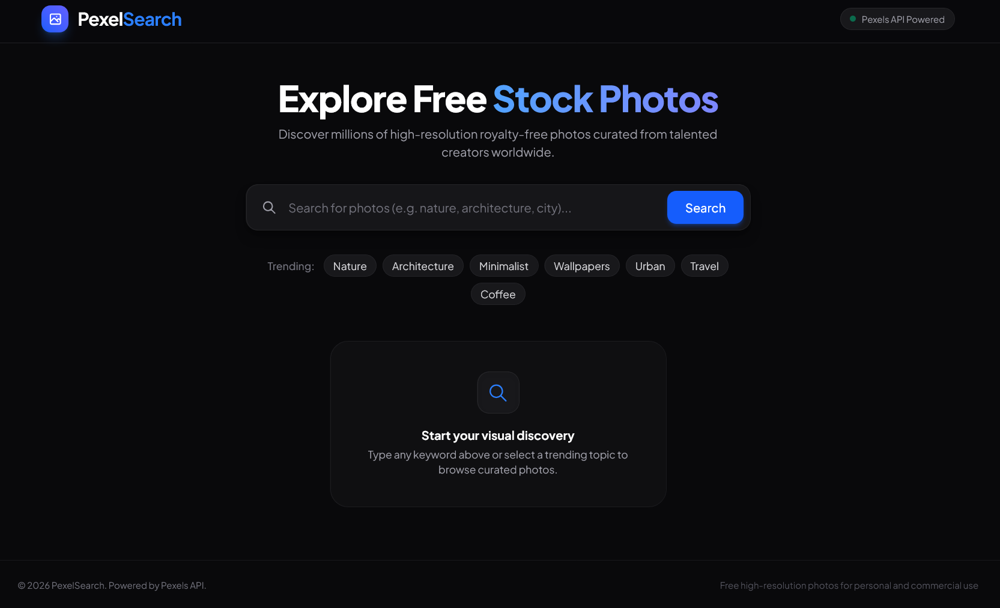
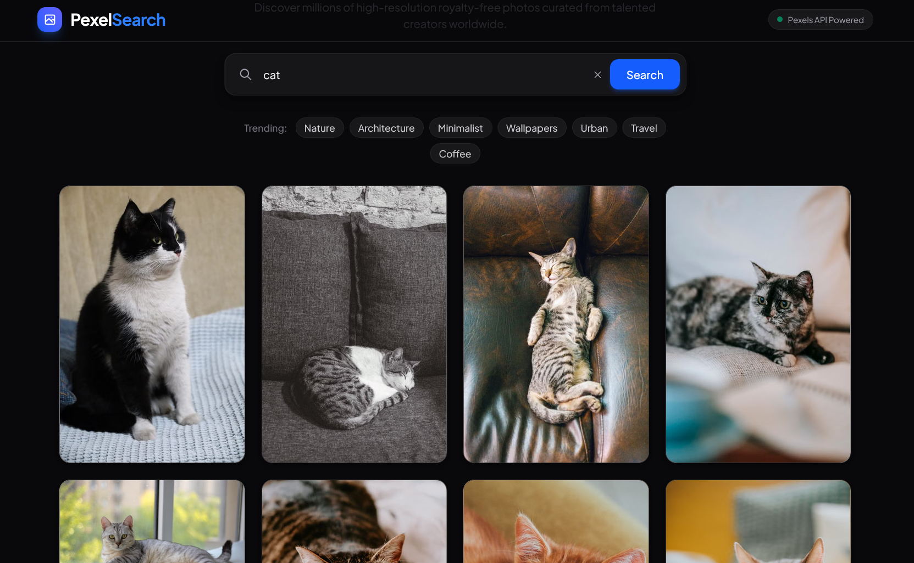
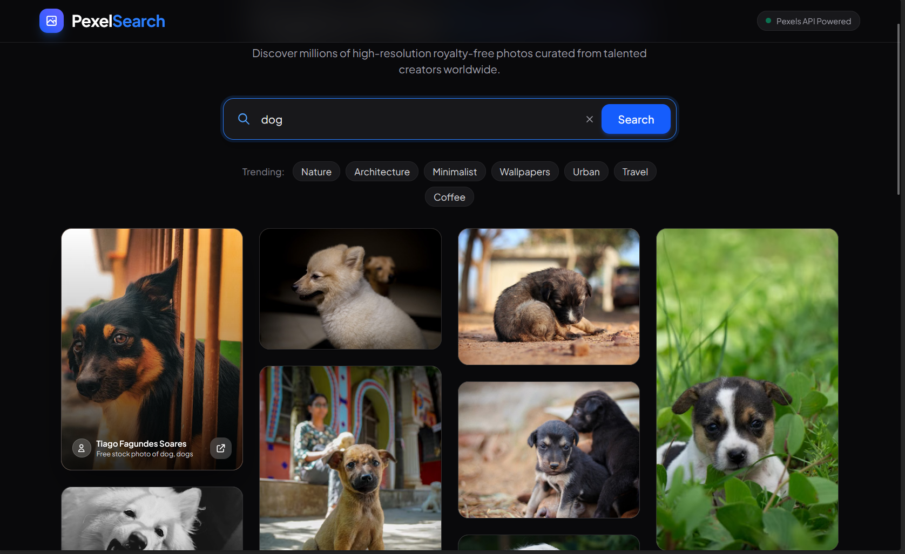

# PexelSearch — Image Search App

A clean, responsive image search application built with React and Tailwind CSS, powered by the Pexels API. Search millions of high-resolution royalty-free photos, explore trending themes, and browse through an adaptive masonry gallery.

---

## How It Works

1. **Query & Discovery**: Enter any keyword in the search bar or pick from curated trending tags (Nature, Architecture, Minimalist, Wallpapers, etc.) to trigger an instant search.
2. **API Integration**: The app sends authenticated requests to the Pexels API via Axios, using an environment variable (`VITE_PEXELS_API_KEY`) to fetch 20 curated photos per page.
3. **Responsive Masonry Grid**: Photos render in an adaptive column layout (1 column on mobile up to 4 columns on desktop) with `loading="lazy"` for smooth browsing.
4. **Zero Layout Shifts**: Each image card dynamically tints its background to the photo's dominant color (`avg_color`) while the image downloads.
5. **Photographer Credits**: Hovering over any photo reveals the creator's name and an external link to view and download the high-resolution original on Pexels.
6. **Incremental Pagination**: The "Load More" action fetches subsequent pages and seamlessly appends new photos to the existing state.

---

## Features

- **Keyword Search**: Quick photo lookups with dedicated clear button and input handling.
- **Trending Tags**: Quick-access pills for popular photography themes.
- **Responsive Masonry Gallery**: Multi-column CSS layout that automatically scales across screen sizes.
- **Color-Matched Placeholders**: Smooth loading experience using Pexels average color metadata.
- **Photographer Attribution**: Direct credits and profile/photo links for all imagery.
- **Load More Pagination**: Paginated results with interactive loading indicators.
- **Graceful UI States**: Includes loading skeletons, friendly empty states, and styled error alerts.
- **Modern Dark Interface**: Built with a sleek zinc palette and responsive mobile-first styling.

---

## Screenshots

### Home Page


### Search Results & Gallery


### Photographer Overlay & Card Details


---

## Tech Stack

- **Frontend**: [React 19](https://react.dev/)
- **Build Tool**: [Vite](https://vite.dev/)
- **Styling**: [Tailwind CSS v4](https://tailwindcss.com/)
- **HTTP Client**: [Axios](https://axios-http.com/)
- **API**: [Pexels API](https://www.pexels.com/api/)

> **Note on AI Usage**:
> Artificial Intelligence (AI) was utilized strictly for **UI styling refinements, Tailwind CSS consistency, and documentation**. The core application logic, component architecture, state management, and functional features were independently written and developed.

---

## Getting Started

### Prerequisites
Make sure you have:
- [Node.js](https://nodejs.org/) (v18 or newer recommended)
- A free API key from [Pexels](https://www.pexels.com/api/)

### Installation

1. **Clone the repository**:
   ```bash
   git clone https://github.com/adhithyan-h-nair/image-search-app.git
   ```

2. **Navigate into the project directory**:
   ```bash
   cd image-search-app
   ```

3. **Install dependencies**:
   ```bash
   npm install
   ```

4. **Configure your API key**:
   Create a `.env` file in the root directory:
   ```env
   VITE_PEXELS_API_KEY=your_pexels_api_key_here
   ```

5. **Start the development server**:
   ```bash
   npm run dev
   ```
   Open `http://localhost:5173` (or the port shown in your terminal).

### Production Build

To create an optimized production build:
```bash
npm run build
```

To preview the production build locally:
```bash
npm run preview
```

---

## License & Attribution

Photos provided courtesy of creators on [Pexels](https://www.pexels.com/) under the [Pexels License](https://www.pexels.com/license/). This project was created for educational and practice purposes.
